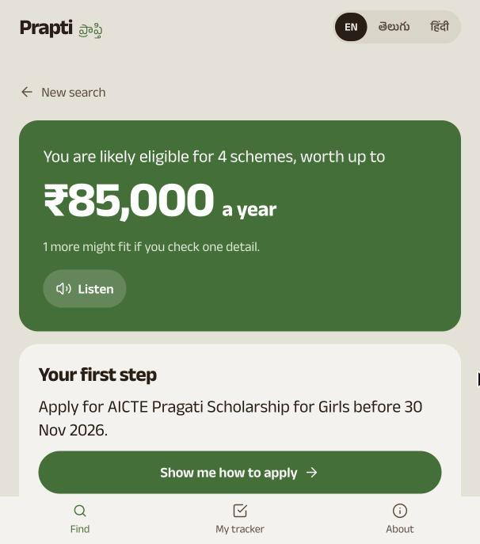
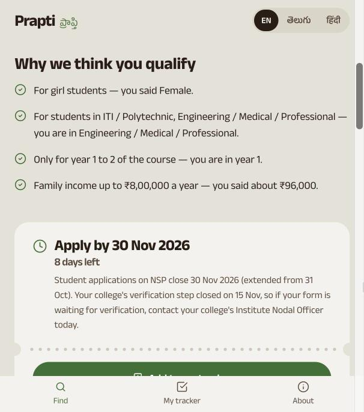
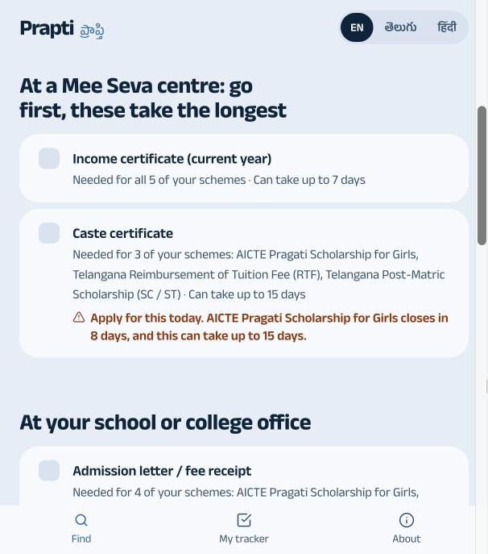

# Prapti (ప్రాప్తి · प्राप्ति): receive what's yours

**ACE Builders Hackathon 2026 · Problem Statement 5: Claim What's Yours**

A student from a low-income family in Telangana describes their life in plain words, the way they would type it to a friend. Prapti shows which scholarships they are **likely eligible** for, the exact rule behind every match, one combined document list, the steps on the official portal, and reminders before each last date. Free, in English, Telugu and Hindi, works offline once opened, and never asks for an ID number.

*Prapti* (ప్రాప్తి in Telugu, प्राप्ति in Hindi) means "receiving what is due to you".

## Try it

**https://prapti-telangana.vercel.app** · open it on a phone, nothing to install.

**In a hurry? https://prapti-telangana.vercel.app/demo** is a 90-second guided tour of a real result: press Next, it spotlights each feature.

Paste any of these into the box on the home page:

| Style | Message |
|---|---|
| Telugu in English letters | `nenu ammayi, B.Tech first year, memu SC, aadayam nelaku 8 velu, Nalgonda palle` |
| Hindi in English letters | `main inter 2nd year me padh rahi hoon, OBC, ghar ki income 1.5 lakh, gaon` |
| Telugu | `నేను డిగ్రీ మొదటి సంవత్సరం, మా ఊరు నల్గొండ, మేము SC, మా ఆదాయం 80 వేలు` |
| English | `I'm a boy in degree 1st year, BC, income 1.7 lakh, village, 78%` (shows "nearly a match") |

Or tap **Answer simple questions** for a no-typing path. The scheme editor (`/admin/schemes`, password `prapti-demo`) is a sandbox on the demo: your changes show up in your own results but nobody else's.

<p>



</p>

## What it does, against the brief

| The brief asks for | In Prapti |
|---|---|
| Plain-language input, typed or spoken, regional language | One text box, or voice with a language pill (English, Telugu, Hindi). Reads English, Telugu, Hindi, and Telugu or Hindi typed in English letters ("aadayam nelaku 8 velu" = ₹96,000 a year); Telugu and Hindi digits too. The reader needs no internet, and pages you have opened keep working offline (service worker). |
| Help for people who don't know which details matter | Asks only the questions whose answer would change a result, one tap each, with "why we ask". A tap-only path for people who find typing hard, and read-aloud. |
| Matching that shows its reasoning | A plain rules engine. Every scheme lists each rule as a sentence with the student's own answer. If only income or marks stands in the way, it says so: "Nearly a match · ₹20,000 over the income limit". |
| *(beyond the brief)* "What if?" | On every result, sliders for family income and marks re-check all schemes live and show the exact limit that decides each one ("≤ ₹2L" crossed out), so a student sees what stands between them and the money. Nothing is saved. |
| Personalised document checklist and step-by-step guide | Each scheme's checklist shows only the documents this student needs. **One trip to Mee Seva**: all documents for all their schemes, listed once and grouped by where to get them ("5 schemes ask for 30 documents, but only 8 are different"). Portal steps and what happens after applying. |
| Deadline reminders and tracking | Tracker with status, days left, documents ready and the next step; reminders 14/7/3/1 days before; calendar file. Warns when a certificate takes longer than the days left ("caste certificate can take 15 days, Pragati closes in 8: apply today"). |
| Every scheme linked to its official source, with the date it was last verified | Shown on every scheme. **How we keep the rules right** (`/changes`): a button re-reads the official pages and compares them with the copies saved when we last checked, so a changed page is flagged for re-checking. |

Also: send the results on WhatsApp in the student's language, with a link that reopens them on a parent's or teacher's phone; Helper mode for NGOs and Mee Seva operators; a closed scheme is shown as closed and never counted in the "worth up to" amount.

## Guardrails

- Says **"likely eligible"**, never "guaranteed". A test scans the pages for banned phrases.
- **No ID numbers.** Aadhaar-, PAN- and phone-like numbers are removed before anything reads the message. Share links hold only the answers, never a name or ID.
- **Rules are data** (`data/schemes.json`): a new income limit is one number to change, with no code change, and the change is logged.
- **Public information only**, sample students only. The tracker and checklists live on the user's own phone; there are no accounts.
- **Never guesses a detail.** On 72 test messages the reader filled in no detail that the message did not state.
- Security basics on the live site: content security policy, no framing, secure HttpOnly SameSite cookies, request size limit.

## How accurate is the reader?

`python scripts/reader_eval.py` scores the offline reader on realistic messages in five styles (English, Telugu, Hindi, Telugu in English letters, Hindi in English letters), including traps like "B.Sc" (not the SC community), "St. Joseph's school" (not ST), "60% handicapped" (not exam marks) and "my father, he is a farmer" (not the student's gender).

| Set | Messages | Details read correctly | Details invented |
|---|---|---|---|
| Practice + traps | 52 | 258 / 258 | 0 |
| Held out (never tuned on) | 20 | 96 / 96 | 0 |

Before this work the same reader scored 87% and 85%. Honest caveat: we wrote these messages ourselves, so real students will find phrasings we missed. The test runs with the other tests, so the score cannot quietly slip.

## Who pays

The gap: in 2023-24 only 4,20,262 fresh students registered on Telangana's ePASS portal against about 5.50 lakh expected, and the deadline was extended ([Telangana Today, 1 Feb 2024](https://telanganatoday.com/telangana-govt-extends-last-date-for-registration-of-post-matric-scholarships)).

Free for students, replacing middlemen who charge ₹500–2,000 per application. CSR funds sponsor districts and get an outcome report. NGOs and Mee Seva centres use **Helper mode** (`/helper`): one student after another under nicknames, impact counts, and a printable checklist for students without phones. Banks pay referral fees on loan schemes only, never ranked above free schemes. Districts or the state can run it as a pilot. Running cost stays near zero (plain rules, no paid AI, free-tier hosting). Next step: a pilot with three colleges or NGOs in Warangal and Nalgonda. Full table on `/about`; proposed pilot prices in SUBMISSION.md.

## Run it

```bash
python3 -m venv .venv && source .venv/bin/activate
pip install -r requirements.txt
python app.py            # http://127.0.0.1:5050
```

Tests (53, no network needed):

```bash
PRAPTI_AI=off python -m unittest discover -s tests -t .
```

| Variable | What it does |
|---|---|
| `ADMIN_PASSWORD` | Scheme editor password (demo default `prapti-demo`). |
| `PRAPTI_SANDBOX` | `1` keeps editor changes in each visitor's own session (on by default on Vercel). |
| `SECRET_KEY` | Signs the session cookie; without it a random key is kept in `.secret_key`. |
| `ANTHROPIC_API_KEY` | Optional: lets an AI model read messages the offline reader cannot. Off on the demo; the rules engine always decides eligibility. |

## How it is built

```
app.py                  Flask: home, questions, results, scheme, one-trip list, tracker, share links,
                        helper, about, /changes, sandboxed scheme editor, JSON API, security headers
engine/extract.py       Plain words -> profile: ID scrubber + offline reader (5 writing styles)
engine/match.py         Rules engine: likely / might be / not a match, reasons, near misses
engine/sources.py       Official-page watcher: text snapshots and change check
engine/llm.py           Optional AI reading (never decides eligibility)
engine/ics.py           Calendar file with reminders
data/schemes.json       10 schemes: rules, documents (tagged by place and time), steps, sources, checks
data/i18n.json          Every screen in English, Telugu and Hindi
data/source_snapshots/  Text of the official pages when last checked
scripts/                reader_eval.py (accuracy), snapshot_sources.py (take page snapshots)
tests/                  53 tests: matching, reading accuracy, flow, languages, editor, sharing, security
```

Hosted free on Vercel (Mumbai region). No database, no paid services.

## Schemes covered

Telangana ePASS Post-Matric (SC/ST, BC/EBC, Minorities), Reimbursement of Tuition Fee, Pre-Matric (Class 9–10); NMMS; Central Sector Scholarship; AICTE Pragati; AICTE Saksham; PM-Vidyalaxmi education loan. Dates and limits re-checked on 22 Nov 2026; each scheme records its sources and confidence in a `verification` block.

## Honest limits

- Telugu and Hindi text is a first draft; it needs a native speaker's review before launch. Portal steps are in English, as on the portals.
- ePASS has not published a 2026-27 last date, so none is shown ("apply early"). ePASS limits come from 2026-27 guides because the official notices could not be read online.
- The Pre-Matric (Class 9–10) income limit is not confirmed; it is marked "not verified".
- The AICTE website refuses automated visits, so Pragati and Saksham are checked by hand.
- "Top 20% of the Class 12 board" is approximated as 80% marks; a Class 10 GPA is converted with the common ×9.5 rule (the board publishes no official formula).

## Credits

Illustrations drawn for Prapti (static/img/art, SVG). Typefaces: Anek Latin, Anek Telugu, Anek Devanagari by Ek Type (Google Fonts, OFL).

Photographs (static/img/photos), both CC BY-SA 4.0 via Wikimedia Commons, credited on the pages where they appear:
- "Dome of Arts College, Osmania University" by Achalamunigal, https://commons.wikimedia.org/w/index.php?curid=46299151
- "Kakatiya Kala Thoranam -Warangal -Telangana -001" by Bharat Kumar Jonnalagadda, https://commons.wikimedia.org/w/index.php?curid=81762698

*Prapti is a free guide, not a government website. Final eligibility is decided by the scheme authority. Never pay anyone to apply.*
